# Assignment — Deploy EpicBook with Terraform and Ansible Roles

Part of the DevOps Micro Internship (DMI) with Agentic AI

---

## Purpose

In this assignment, you will deploy the EpicBook web application using Terraform and Ansible roles.

Terraform provisions the cloud infrastructure, including one Ubuntu VM and one managed MySQL database. Ansible roles configure the VM, install required software, deploy the EpicBook application, configure Nginx, connect the app to the managed MySQL database, and verify the deployment.

---

# Task 1 — Set Up the Project Folder Layout

## Goal

Create the project folder structure for Terraform and Ansible roles.

Terraform will be used to provision the cloud infrastructure. Ansible roles will be used to configure the VM and deploy the EpicBook application.

### Evidence

#### Screenshot 1 — Terminal showing the completed `epicbook-prod` project structure

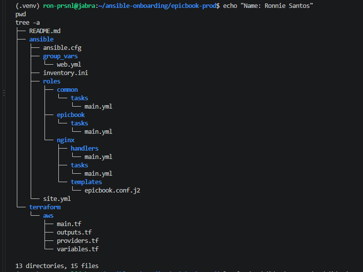
---

### Notes

**1. Which cloud provider did you choose for this assignment?**

AWS, in the `ap-southeast-1` (Singapore) region, using a separate free-tier training account through the `dmi-free` CLI profile. The VM is an EC2 instance and the managed MySQL database is Amazon RDS. The Terraform files are under `terraform/aws/` only, as the assignment requires.

---

**2. Why is it useful to keep Terraform files and Ansible files in separate folders?**

The two tools do different jobs. Terraform creates the infrastructure (the network, security groups, VM, and database), and Ansible configures what runs on the VM. Keeping them in separate folders makes each side easier to find, read, and change without touching the other. I can redeploy the application with Ansible without re-running Terraform, or change the infrastructure without editing any roles. It also keeps their files apart: Terraform's state and `tfvars` stay under `terraform/aws/`, and the inventory, roles, and variables stay under `ansible/`.

---

**3. What is the purpose of the `roles` directory in Ansible?**

The `roles` directory holds reusable units of configuration, each responsible for one part of the server. In this project, `common` installs the base packages, `nginx` sets up the reverse proxy, and `epicbook` deploys and runs the application. Each role has a standard structure (`tasks/`, `templates/`, `handlers/`) that Ansible finds automatically, so `site.yml` only needs to list the roles in order. Splitting the work this way keeps the main playbook short and makes each role easier to test, troubleshoot, and reuse in other projects.

---

# Task 2 — Provision the Infrastructure with Terraform

## Goal

Run Terraform to provision the cloud infrastructure for the EpicBook deployment.

Terraform will create the VM, managed MySQL database, networking, security rules, and required outputs.

### Evidence

#### Screenshot 2 — `terraform apply` completed successfully

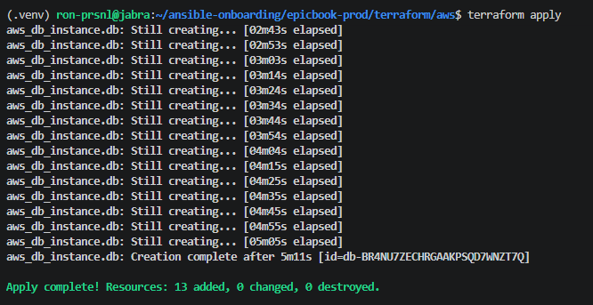

---

#### Screenshot 3 — Output of `terraform output`

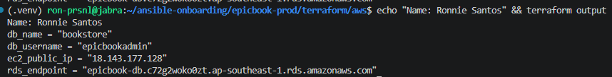

---

#### Screenshot 4 — Azure Portal or AWS Console showing the VM running

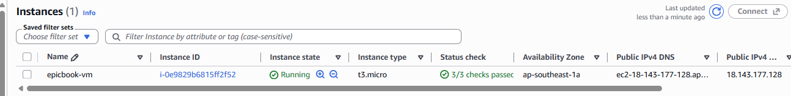

---

#### Screenshot 5 — Azure Portal or AWS Console showing the managed MySQL database created

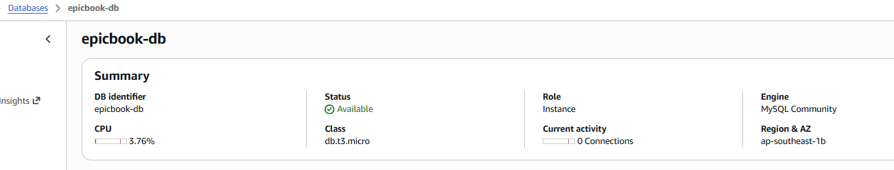

---

### Notes

**1. What resources did Terraform create for this assignment?**

Terraform created 13 resources on AWS in `ap-southeast-1`:

- **Network:** a VPC (10.0.0.0/16), a public subnet for the VM, two private subnets in different Availability Zones for the database, an internet gateway, and a route table with its association for the public subnet.
- **Security:** two security groups. `epicbook-ec2-sg` allows SSH (22) only from my controller's IP and HTTP (80) from anywhere. `epicbook-rds-sg` allows MySQL (3306) only from the EC2 security group.
- **Compute:** an SSH key pair from my controller's public key, and an Ubuntu 22.04 EC2 instance (`epicbook-vm`, `t3.micro`) with its hostname set to `epicbook`.
- **Database:** a DB subnet group across the two private subnets, and an RDS MySQL 8.0 instance (`epicbook-db`, `db.t3.micro`) with the `bookstore` database created automatically and public access disabled.

The outputs expose the VM's public IP, the RDS endpoint, the database name, and the database username.

---

**2. Why should you review `terraform plan` before running `terraform apply`?**

`terraform plan` shows exactly what will be created, changed, or destroyed before anything happens. It's the last chance to catch a mistake, such as the wrong region, a security rule open to `0.0.0.0/0`, or a resource being replaced unexpectedly. Before applying, I checked that the plan showed 13 resources to add and nothing to change or destroy, that the SSH rule used my `/32`, and that the database had `publicly_accessible = false`. Catching a problem in the plan costs nothing; catching it after apply can mean exposed resources, lost data, or unexpected charges.

---

**3. Why should database passwords not be shown in Terraform output?**

Terraform output is printed in the terminal, can end up in screenshots, CI/CD logs, and shell history, and is easy for other tools to read. A password shown there can leak without anyone noticing. In my setup, the password was generated randomly and written straight to `terraform.tfvars`, which is gitignored, without being printed. The variable is marked `sensitive = true`, so Terraform hides it in plan and apply output, and `outputs.tf` deliberately has no password output, only the host, database name, and username that Ansible needs.

---

# Task 3 — Verify SSH Key-Based Access

## Goal

Verify that the cloud VM can be accessed from the Ansible controller using SSH key-based authentication.

### Evidence

#### Screenshot 6 — Successful SSH hostname check from the Ansible controller

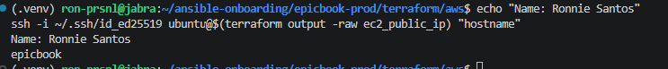

---

### Notes

**1. What command did you use to verify SSH access?**

From `terraform/aws`, I ran:

    ssh -i ~/.ssh/id_ed25519 ubuntu@$(terraform output -raw ec2_public_ip) "hostname"

`-i` points SSH at the private key that matches the key pair Terraform registered. `ubuntu` is the default user for AWS Ubuntu AMIs. `terraform output -raw ec2_public_ip` supplies the VM's IP directly from Terraform, so there was nothing to copy by hand. `"hostname"` runs that single command on the VM and returns the result.

---

**2. What proves that SSH key-based access worked successfully?**

The command returned the VM's hostname, `epicbook`, without asking for a password. That means the key was accepted, the security group allowed my controller's IP on port 22, and the VM was up and running SSH. The hostname also confirms I reached the right machine, since cloud-init set it from the Terraform configuration. On the first connection I accepted the server's fingerprint once; after that, it connected with no prompts at all.

---

**3. What would you check if SSH returned `Permission denied (publickey)`?**

That error means the connection reached the server, so the network and security group are fine, but authentication failed. I would check:

- **The username:** AWS Ubuntu AMIs use `ubuntu`, not `root`, `ec2-user`, or `azureuser`.
- **The key:** confirm `-i` points to the private key matching the public key in `aws_key_pair`. Comparing `ssh-keygen -lf ~/.ssh/id_ed25519.pub` with the key pair's fingerprint in the EC2 console shows whether they match.
- **Key permissions:** the private key must be `600` (`chmod 600 ~/.ssh/id_ed25519`), or SSH refuses to use it.
- **The agent:** `ssh-add -l` shows whether the key is loaded.
- **Verbose output:** `ssh -vvv ...` shows which keys were offered and why each one was rejected.

A timeout would be a different problem, usually the security group or a changed controller IP rather than the key.
# Task 4 — Create the Ansible Inventory and Configuration

## Goal

Create the Ansible inventory file and local Ansible configuration for the EpicBook VM.

The inventory tells Ansible which VM to manage and which SSH user to use.

### Evidence

#### Screenshot 7 — `inventory.ini` showing the VM under the `web` group

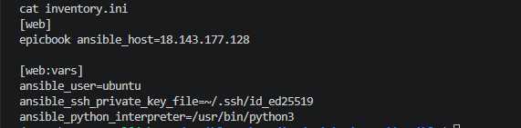

---

#### Screenshot 8 — Output of `ansible-inventory -i inventory.ini --graph`

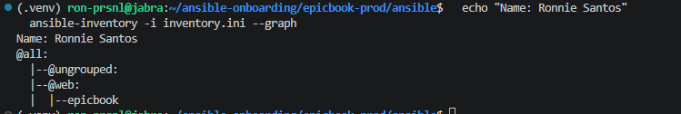

---

#### Screenshot 9 — Output of `ansible web -i inventory.ini -m ping`

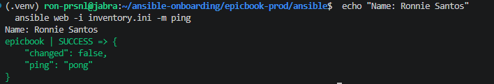

---

### Notes

**1. What is the purpose of `inventory.ini`?**

It tells Ansible which servers to manage and how to connect to them. My inventory puts the VM in a `web` group, which is the group `site.yml` targets with `hosts: web`, and sets the connection details for that group under `[web:vars]`: the SSH user, the private key path, and the Python interpreter on the VM.

---

**2. What does `ansible_host` store?**

The real address Ansible connects to: the VM's public IP, `18.143.177.128`, taken from `terraform output ec2_public_ip`. The host is named `epicbook` in the inventory, a friendly label that appears in Ansible's output, while `ansible_host` supplies the actual IP. If the IP changes after a rebuild, only this one value needs updating.

---

**3. What does `ansible_ssh_private_key_file` tell Ansible?**

It tells Ansible which private key to use when connecting over SSH. In my case it's `~/.ssh/id_ed25519`, the controller key whose public half Terraform registered as the `epicbook-key` key pair. It's the same key I used for the manual SSH test in Task 3, so Ansible connects exactly the way I already proved works.

---

**4. Why is `host_key_checking = False` used only for this temporary lab?**

With it disabled, Ansible connects without confirming the server's SSH fingerprint, so a brand-new VM doesn't stop the run with a yes/no prompt Ansible can't answer. That's acceptable here because the VM is short-lived and I created it myself moments earlier. In production it should stay enabled, because fingerprint checking is what detects man-in-the-middle attacks or a server that has been unexpectedly replaced. The right approach there is to keep checking on and pre-load trusted fingerprints into a managed `known_hosts` file.
---

# Task 5 — Create the Main Ansible Playbook

## Goal

Create the main Ansible playbook that runs the required roles in the correct order.

The `site.yml` file will call the `common`, `nginx`, and `epicbook` roles.

### Evidence

#### Screenshot 10 — `site.yml` showing the roles in the correct order

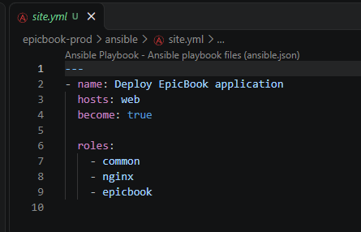

---

#### Screenshot 11 — Output of `ansible-playbook -i inventory.ini site.yml --syntax-check`

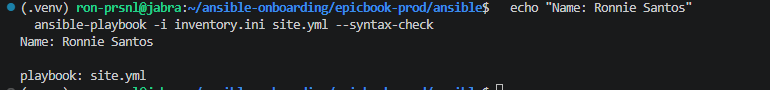

---

### Notes

**1. What is the purpose of `site.yml`?**

`site.yml` is the main entry point for the deployment. It doesn't contain any configuration tasks itself. It says which hosts to target (`hosts: web`), that tasks need root privileges (`become: true`), and which roles to run and in what order. All the actual work lives inside the roles, so `site.yml` stays short and the whole deployment runs with one command: `ansible-playbook -i inventory.ini site.yml`.

---

**2. Why should the roles run in the order `common`, `nginx`, and `epicbook`?**

Each role depends on the one before it, and Ansible runs roles in the order they're listed. `common` goes first because it installs the base tools the later roles need, such as Git, Node.js, npm, and the MySQL client. `nginx` goes second so the reverse proxy is installed and configured before the application starts. `epicbook` goes last because cloning the app, importing the database, and starting it with PM2 all depend on those tools and on Nginx being ready to forward traffic to it.

---

**3. What does `become: true` allow Ansible to do?**

Ansible connects as the `ubuntu` user, which doesn't have root privileges by default. `become: true` tells Ansible to escalate to root with `sudo` for the tasks in this play. That's needed to install packages with `apt`, write Nginx configuration under `/etc/nginx`, manage system services, and install PM2 globally. Without it, those tasks would fail with permission errors.

---

# Task 6 — Create the `common` Role

## Goal

Create the `common` role to prepare the Ubuntu VM with the basic packages required for the EpicBook deployment.

This role handles the common server setup before Nginx and the application are configured.

### Evidence

#### Screenshot 12 — `roles/common/tasks/main.yml` showing the common setup tasks

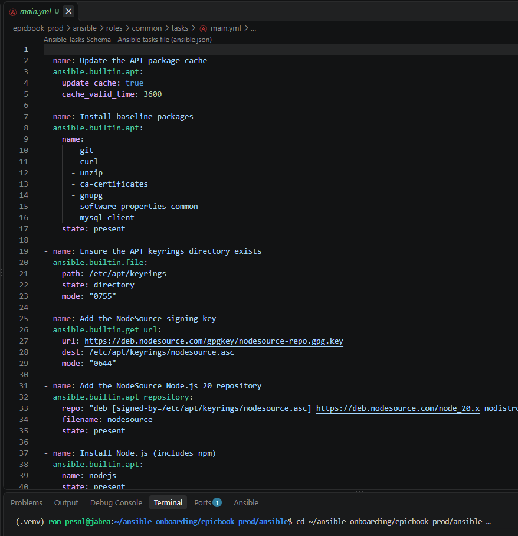
---

### Notes

**1. What is the responsibility of the `common` role?**

The `common` role prepares the server before anything application-specific is installed. It refreshes the apt package cache, installs the baseline tools (Git, curl, unzip, CA certificates, GnuPG, software-properties-common, and the MySQL client), and installs Node.js 20 with npm from the NodeSource repository. These are the shared building blocks the `nginx` and `epicbook` roles depend on, so this role runs first.

---

**2. Why should Nginx installation not be placed inside the `common` role?**

Each role should have one clear responsibility. Nginx isn't just a package: it has its own configuration template, a handler to reload it, and its own enable, disable, and validate steps. Keeping it in a dedicated `nginx` role means everything about the reverse proxy lives in one place, so it's easier to troubleshoot and can be reused in another project without bringing along unrelated setup. It also keeps `common` truly common, since not every server that needs base tools needs a web server.

---

**3. Why is `mysql-client` useful in this deployment?**

The database is a managed RDS instance on a private subnet, so the VM is the only place that can reach it. `mysql-client` lets the `epicbook` role connect from the VM to check whether the `bookstore` tables already exist and to import the schema and seed SQL files only if they don't. It's also useful for troubleshooting: running `mysql -h <rds_endpoint> -u epicbookadmin -p -e "SELECT 1;"` from the VM quickly confirms that the network path, security group, and credentials all work, separately from the application.

---

# Task 7 — Create the `nginx` Role

## Goal

Create the `nginx` role to install Nginx and configure it as a reverse proxy for the EpicBook application.

Nginx will receive browser traffic on port `80` and forward it to the EpicBook Node.js application running on the VM.

### Evidence

#### Screenshot 13 — `roles/nginx/tasks/main.yml` showing Nginx installation and site configuration tasks

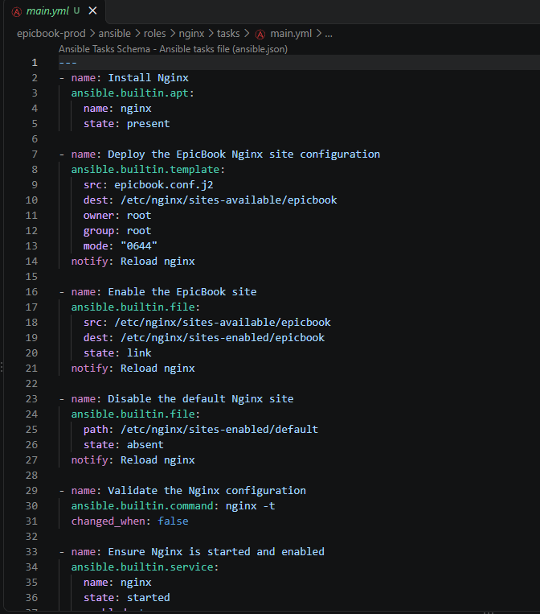

---

#### Screenshot 14 — `roles/nginx/templates/epicbook.conf.j2` showing the reverse proxy configuration

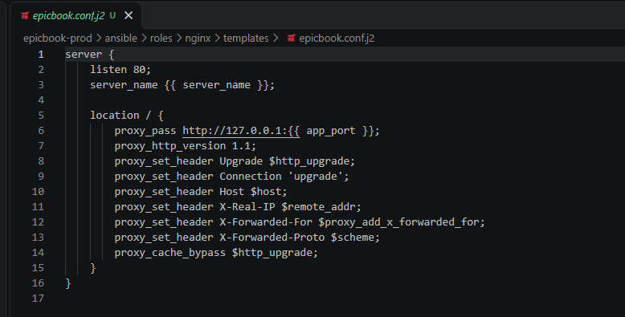

---

### Notes

**1. What is the responsibility of the `nginx` role?**

The `nginx` role installs Nginx and sets it up as the front door for EpicBook. It deploys the `epicbook` site configuration from a template, enables it with a symlink into `sites-enabled`, removes Ubuntu's default site, validates the configuration with `nginx -t`, and makes sure Nginx is running and starts on boot. A handler reloads Nginx only when the configuration actually changes. The role doesn't install or start the application itself; that's the `epicbook` role's job.

---

**2. Why is Nginx configured as a reverse proxy in this deployment?**

EpicBook is a Node.js app listening on port 8080 on the VM. Nginx listens on the standard web port 80 and forwards each request to `127.0.0.1:8080` with `proxy_pass`. Visitors use a normal URL with no port number, and the Node.js app is never exposed directly to the internet: only port 80 is open in the security group, not 8080. Nginx is also better at handling raw web traffic, and the `proxy_set_header` lines pass along the visitor's real IP, hostname, and protocol so the app still sees accurate request details. It also leaves room to add HTTPS or more app servers behind Nginx later without changing the app.

---

**3. Why should the application port come from `group_vars/web.yml` instead of being hard-coded?**

The port is used in two places: the Nginx template (`proxy_pass http://127.0.0.1:{{ app_port }}`) and the PM2 ecosystem file (`PORT`), which tells the app which port to listen on. Defining it once as `app_port` in `group_vars/web.yml` keeps those two in sync. If the port ever changes, I update one value, and both Nginx and the app pick it up on the next run. Hard-coding 8080 in each file would mean editing several files and risking a mismatch, where Nginx forwards to one port while the app listens on another, which would show up as a `502 Bad Gateway`. It also keeps the role reusable for other apps or environments.

# Task 8 — Create the `epicbook` Role

## Goal

Create the `epicbook` role to deploy the EpicBook application, connect it to the managed MySQL database, and run the application on port `8080` using PM2.

### Evidence

#### Screenshot 15 — `roles/epicbook/tasks/main.yml` showing application deployment tasks

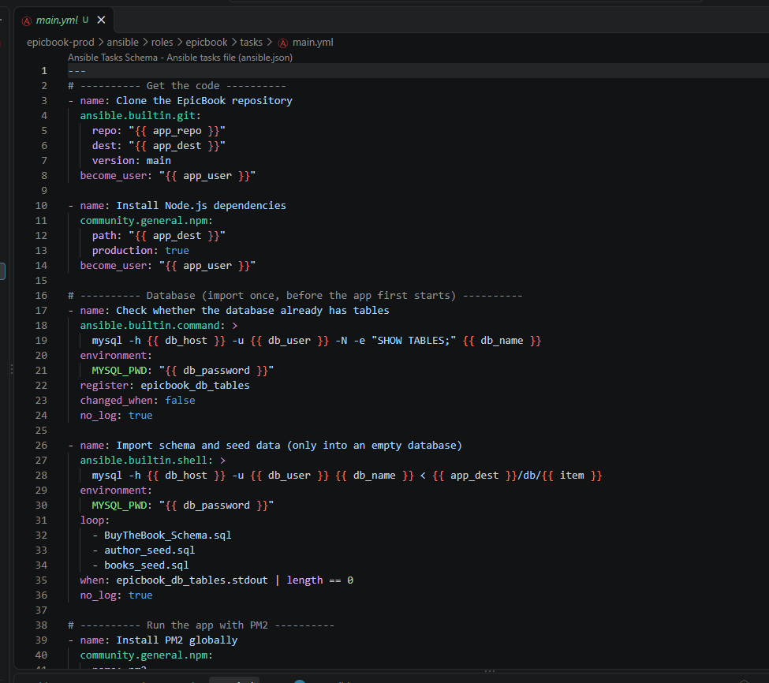

---

#### Screenshot 16 — Task or file showing how the database connection is configured, with secrets hidden

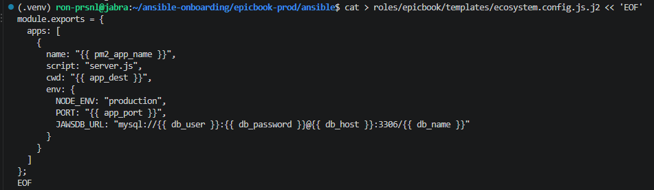

---

#### Screenshot 17 — Task or output showing the EpicBook application managed by PM2

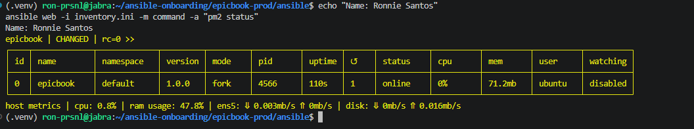

---

### Notes

**1. What is the responsibility of the `epicbook` role?**

The `epicbook` role gets the application onto the server, connects it to the database, and keeps it running. It clones the EpicBook repository into `/home/ubuntu/epicbook`, installs the Node.js dependencies, and checks whether the RDS `bookstore` database already has tables. It imports the schema and seed SQL files only if the database is empty. It then installs PM2, deploys a PM2 ecosystem file with the app's environment (`NODE_ENV`, `PORT`, and the `JAWSDB_URL` connection string), starts the app if it isn't already running, saves the process list, and registers PM2 to start on boot. A handler reloads the app only when the ecosystem file changes.

---

**2. Why is PM2 used for the EpicBook Node.js application?**

Running `node server.js` directly ties the app to a terminal session: it stops when the session ends, and it stays down if it crashes. PM2 runs the app in the background as a managed process, restarts it automatically if it crashes, and with `pm2 startup` and `pm2 save` brings it back after a server reboot. It also gives simple management commands: `pm2 status` shows whether the app is online, its uptime, memory, and restart count, and `pm2 logs` shows its output for troubleshooting. That's how I confirmed `epicbook` was online and stable, running as `ubuntu`.

---

**3. Why should database passwords not be hard-coded in public files?**

Anything committed to a repository can be read by anyone with access to it, and once pushed, it stays in the Git history even if it's deleted later. A hard-coded password could let someone connect to the database and read, change, or delete its data. In this project, the password was generated randomly and kept in the gitignored `terraform.tfvars`. In Ansible, it's stored only as Vault-encrypted ciphertext in `group_vars/web.yml`. The templates contain only the variable name `{{ db_password }}`, and the tasks that use the password have `no_log: true` and pass it through the `MYSQL_PWD` environment variable, so it never appears in output or in the VM's process list.

---

**4. What does it mean for the application to run on port `8080` while Nginx listens on port `80`?**

They're two separate processes on the same VM. The Node.js app listens on port 8080, but only locally, because the security group doesn't open that port to the internet. Nginx listens on port 80, the standard HTTP port, and forwards every request to `127.0.0.1:8080`. Visitors only ever talk to Nginx at `http://<public_ip>`, with no port number, and Nginx passes the request to the app and returns its response. I verified both layers: `curl -I http://localhost:8080` on the VM returned 200 directly from Express, and `curl -I http://<public_ip>` from my controller returned the same page with `Server: nginx` and `X-Powered-By: Express`, showing the proxy was working.

---

# Task 9 — Create Group Variables

## Goal

Create reusable variables for the EpicBook deployment.

The `group_vars/web.yml` file stores values that can be reused across the Ansible roles.

### Evidence

#### Screenshot 18 — `group_vars/web.yml` showing the application, PM2, and database variables, with passwords hidden or masked

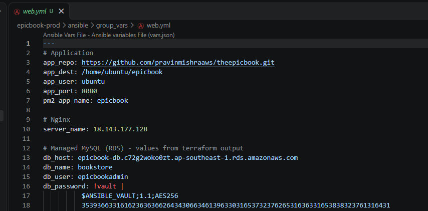

---

### Notes

**1. What is the purpose of `group_vars/web.yml`?**

It holds every value the roles need, in one place, for all hosts in the `web` group. Ansible loads it automatically because its file name matches the `[web]` group in `inventory.ini`. The roles only reference variable names like `{{ app_port }}` or `{{ db_host }}`, so the tasks describe what to do and this file supplies the values. Changing a value, such as the port or the database host after a rebuild, means editing one file instead of every role and template that uses it.

---

**2. Which values did you store in `group_vars/web.yml`?**

- **Application:** `app_repo` (the EpicBook GitHub URL), `app_dest` (`/home/ubuntu/epicbook`), `app_user` (`ubuntu`), and `app_port` (`8080`).
- **PM2:** `pm2_app_name` (`epicbook`).
- **Nginx:** `server_name`, set to the VM's public IP.
- **Database:** `db_host` (the RDS endpoint), `db_name` (`bookstore`), `db_user` (`epicbookadmin`), and `db_password`, which is encrypted.

The IP, database host, name, and username were filled in directly from `terraform output`, so the values Ansible uses always match what Terraform created.

---

**3. How did you handle the database password securely?**

Terraform generated it randomly (`openssl rand -hex 16`) and wrote it straight into the gitignored `terraform.tfvars` without printing it. I then piped it from that file into `ansible-vault encrypt_string`, so it never appeared on screen, and appended the result to `group_vars/web.yml`. The file only contains `db_password: !vault |` followed by AES256 ciphertext. Encrypting it inline kept the required file name and avoided the problem of a separate vault file not being loaded. Ansible decrypts it only when a task needs it, using the vault password I enter with `--ask-vault-pass`. To check it worked without exposing it, I printed only its length (`32`). In the roles, tasks that use it run with `no_log: true` and pass it through `MYSQL_PWD` instead of the command line. On the VM, it ends up only in the PM2 ecosystem file, which is readable by the `ubuntu` user alone (`0600`).

---

# Task 10 — Run the Ansible Playbook

## Goal

Run the Ansible playbook to configure the VM and deploy the EpicBook application.

The playbook should run the roles in this order:

1. `common`
2. `nginx`
3. `epicbook`

### Evidence

#### Screenshot 19 — Ansible playbook output showing the roles running

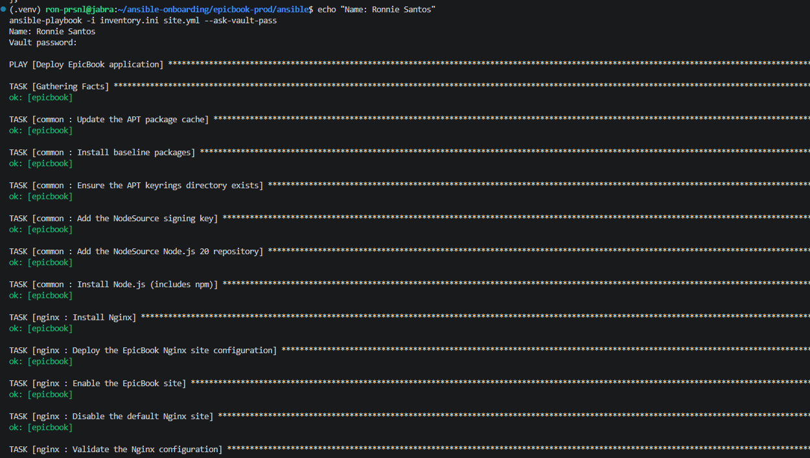

---

#### Screenshot 20 — Final Ansible recap showing `failed=0`

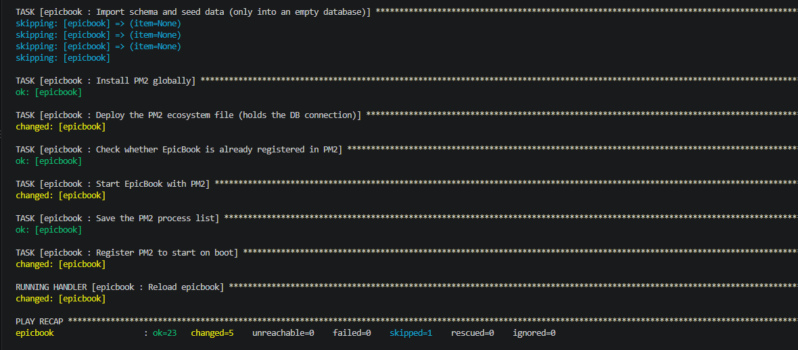

---

#### Screenshot 21 — Output of `ansible web -i inventory.ini -m command -a "systemctl is-active nginx" --become`

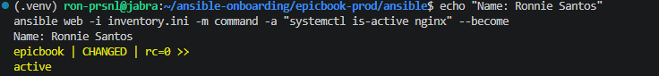

---

#### Screenshot 22 — Output of `ansible web -i inventory.ini -m command -a "pm2 status"`

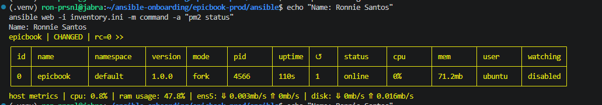

---

#### Screenshot 23 — Output of `ansible web -i inventory.ini -m command -a "curl -I http://localhost:8080"`

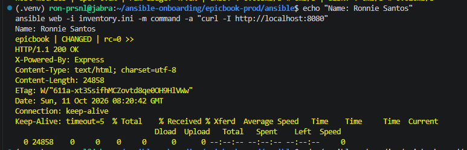

---

### Notes

**1. What command did you run to execute the Ansible playbook?**

From `epicbook-prod/ansible`:

    ansible-playbook -i inventory.ini site.yml --ask-vault-pass

`-i inventory.ini` points Ansible at the `web` group with the VM's IP, and `--ask-vault-pass` prompts for the vault password so Ansible can decrypt `db_password` from `group_vars/web.yml`.

The first run stopped at the PM2 start task, because the ecosystem template file had been overwritten with an empty file. I recreated the template, confirmed its contents with `cat`, and ran the same command again.

---

**2. How do you know all roles completed successfully?**

The output showed tasks from all three roles running in order: `common`, then `nginx`, then `epicbook`. The final `PLAY RECAP` showed `epicbook: ok=23 changed=5 unreachable=0 failed=0 skipped=1`. `failed=0` means every task completed without error. The one skipped task was the database import, which correctly didn't run again because the first run had already loaded the tables. A successful recap only proves the tasks finished, though, so I also checked each layer separately with the commands below.

---

**3. What proves that Nginx is active?**

`ansible web -i inventory.ini -m command -a "systemctl is-active nginx" --become` returned `active` with `rc=0`. That's systemd's own report that the Nginx service is running. It reported `CHANGED` only because the `command` module always does, since it can't tell whether a command changed anything.

---

**4. What proves that PM2 is managing the EpicBook application?**

`ansible web -i inventory.ini -m command -a "pm2 status"` listed the `epicbook` process with status `online`, user `ubuntu`, and an uptime that kept increasing between checks. A process crashing and restarting would show `errored` or a rising restart count. It works without `--become` because the role runs PM2 as the `ubuntu` user. The role also ran `pm2 save` and `pm2 startup`, so PM2 brings the app back automatically after a reboot.

---

**5. What proves that the EpicBook application responds on port `8080`?**

`ansible web -i inventory.ini -m command -a "curl -I http://localhost:8080"` returned `HTTP/1.1 200 OK` with `X-Powered-By: Express` and `Content-Length: 24858`. This request ran on the VM itself and went straight to the Node.js app, bypassing Nginx. The `X-Powered-By: Express` header confirms the response came from the app, and the full-size page shows the home page rendered successfully, which includes loading the book list from the database.
---

# Task 11 — Verify the EpicBook Deployment

## Goal

Verify that the EpicBook application is running, accessible in the browser, and connected to the managed MySQL database.

### Evidence

#### Screenshot 24 — Output of `curl -I http://<public_ip>`

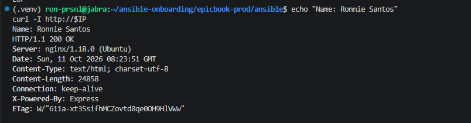

---

#### Screenshot 25 — Output of the cart API test command

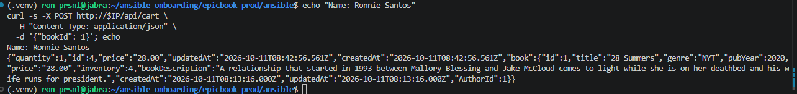

---

#### Screenshot 26 — Output of the `/cart` HTTP status check

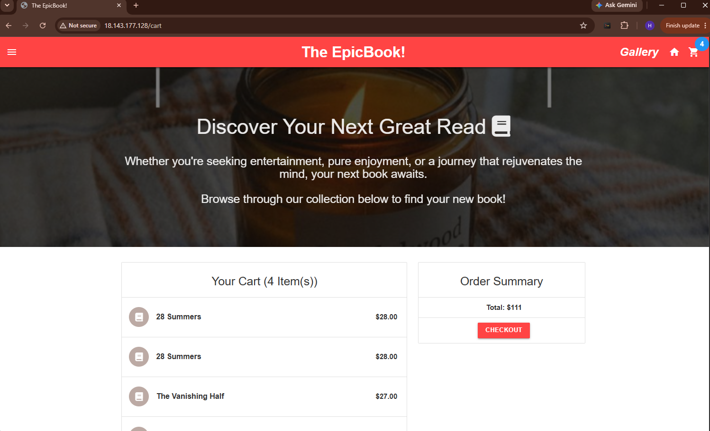

---

#### Screenshot 27 — Browser showing the EpicBook application loaded from `http://<public_ip>`

---

### Notes

**1. What HTTP response did you receive from the public application URL?**

`curl -I http://<public_ip>` from my controller returned `HTTP/1.1 200 OK` with `Server: nginx/1.18.0 (Ubuntu)`, `X-Powered-By: Express`, and `Content-Length: 24858`. The `Server: nginx` header shows the request went through Nginx on port 80. `X-Powered-By: Express` shows Nginx forwarded it to the Node.js app. The content length and ETag matched the local port 8080 check exactly, confirming it was the same EpicBook page, reached through the public internet, the security group, and the reverse proxy.

---

**2. What did the cart API test prove?**

I sent `POST /api/cart` with `{"bookId": 1}` to the public IP. The response was JSON containing a new cart row (`"id": 1`, `"price": "28.00"`) and the book it referenced (`"28 Summers"`). That one request proved the whole path works: Nginx proxied an API request to Express, the app read book 1 from RDS, and it wrote a new row to the `Cart` table. The book's `createdAt` time matched when the seed import ran, which confirms the import loaded the data. Afterwards, the browser's cart page showed that same item alongside items I added by clicking, so writes made through the API and through the browser both landed in the same database.

---

**3. What did the `/cart` status check return?**

`curl -s -o /dev/null -w "%{http_code}" http://<public_ip>/cart` returned `HTTP 200`. The cart page rendered successfully through Nginx: not a `502 Bad Gateway`, which would mean Nginx couldn't reach the app, and not a `404`, which would mean a routing problem. The cart route queries the database to list the items and total, so a 200 here also means those queries succeeded.

---

**4. What issue did you face during verification, and how did you fix it?**

The first public `curl -I` returned `200 OK`, but with `Content-Length: 612` and `Last-Modified` and `ETag` headers, and no `X-Powered-By: Express`. That's Nginx's default welcome page, not EpicBook, even though the app was returning 24,858 bytes locally on port 8080.

The cause was handler behaviour. In the first playbook run, the `nginx` role changed the config and queued the `Reload nginx` handler, but handlers only run at the end of a play, and that run failed later at the PM2 task, so the queued reload was dropped. In the second run, the config files were already correct, so nothing changed, nothing notified the handler, and Nginx kept serving its old in-memory config.

I confirmed `/etc/nginx/sites-enabled/` contained only `epicbook`, so the files were right. I then reloaded Nginx with an ad-hoc `service` command, and the public check returned the real EpicBook page. To prevent it happening again, I added `force_handlers: true` to `site.yml`, so queued handlers still run even if a later task fails.
---

# LinkedIn Post Required

## Evidence

#### LinkedIn Post URL

Paste your LinkedIn post URL here:

`Add your URL here`

---

#### Screenshot — Published LinkedIn post

Add your screenshot here.

---

# Assignment Questions

**1. Why is Terraform used for infrastructure provisioning?**

Terraform describes infrastructure as code, so the whole environment (the VPC, subnets, security groups, EC2 VM, and RDS database) is defined in version-controlled files instead of being clicked together in the console. `terraform plan` shows exactly what will change before anything happens, and `terraform apply` builds it the same way every time. Its state file tracks what it created, so `terraform destroy` removes all 13 resources cleanly, with nothing left behind to bill. Outputs like the VM IP and RDS endpoint feed straight into the next step, the Ansible inventory and variables.

---

**2. Why are Ansible roles useful for production-style deployments?**

Roles split a deployment into focused, reusable pieces. Here, `common` prepares the server, `nginx` sets up the reverse proxy, and `epicbook` deploys the app. Each role has a standard layout (`tasks/`, `templates/`, `handlers/`) that Ansible finds automatically, so `site.yml` stays short and readable. When something breaks, the output shows which role failed, which narrows troubleshooting. Roles also take their values from variables rather than hard-coded settings, so the same `nginx` role could front a different app, or the same roles could deploy to a staging environment just by changing `group_vars`.

---

**3. What is the purpose of `group_vars/web.yml`?**

It centralizes the values every role needs for the `web` group: the repository URL, install path, app user, port, PM2 process name, Nginx server name, and database connection details. Ansible loads it automatically because its name matches the `[web]` inventory group. The roles reference variables like `{{ app_port }}` and `{{ db_host }}`, so a change, such as a new RDS endpoint after a rebuild, is made once here instead of in every task and template. It also holds the database password as Vault-encrypted ciphertext, so the secret can live alongside the other settings without being readable.

---

**4. Why should database passwords not be committed to GitHub?**

Anything pushed to GitHub can be read by anyone with access to the repository, or by everyone if it's public, and it stays in the Git history even after the file is deleted. Automated bots scan public repositories for credentials within minutes of a push. A leaked database password could let someone read, change, or wipe the data. In this project, the password lives only in the gitignored `terraform.tfvars` and as encrypted ciphertext in `group_vars/web.yml`, and I checked `git status` before committing to confirm no state or `tfvars` files were staged.

---

**5. What is the purpose of Nginx in this deployment?**

Nginx is the public entry point. It listens on port 80 and forwards requests to the EpicBook Node.js app on `127.0.0.1:8080`. Visitors reach the site at a normal URL with no port number, and the app itself is never exposed to the internet, since only port 80 is open in the security group. Nginx also passes along the visitor's real IP, hostname, and protocol through `proxy_set_header`, and it's the natural place to add HTTPS, caching, or more app servers later without changing the application.

---

**6. Why should the managed MySQL database not be publicly accessible?**

The database holds the application's data, and only the application needs to talk to it. RDS is in private subnets with `publicly_accessible = false`, so it has no public IP. Its security group allows port 3306 only from the EC2 security group, not from any IP range. Even if someone learned the endpoint or the password, they couldn't reach the database from the internet. A publicly reachable MySQL port is a constant target for scanning and brute-force attacks, and keeping it private removes that risk entirely.

---

**7. Why is PM2 used for the EpicBook Node.js application?**

Running `node server.js` directly ties the app to a terminal: it stops when the session ends and stays down if it crashes. PM2 runs it as a managed background process, restarts it automatically if it crashes, and with `pm2 save` and `pm2 startup` brings it back after a reboot. It also makes the app easy to check and manage: `pm2 status` showed `epicbook` online under the `ubuntu` user with its uptime and memory, and `pm2 logs` is the first place to look when something goes wrong.

---

**8. What does idempotency mean in Ansible?**

It means running the same playbook again only changes what isn't already in the desired state, so repeated runs are safe. Most Ansible modules check the current state first: `apt` with `state: present` doesn't reinstall packages, and `template` only rewrites a file if its content differs. For things modules can't check on their own, I added guards. The database import runs only when `SHOW TABLES` returns nothing, which is why the second run reported it as `skipped` instead of failing on duplicate tables. PM2 only starts the app if `pm2 describe` shows it isn't registered, and `cache_valid_time` stops the apt cache refresh from running on every pass.

---

**9. What issue did you face during the deployment, and how did you fix it?**

The first playbook run got through `common`, `nginx`, the clone, `npm install`, and the database import, then failed at the PM2 start task with `Applications not running` and `No script path - aborting`. The double space in the message suggested PM2 had found an app with no name. I reproduced the error in a test environment and confirmed PM2 gives exactly that message when the ecosystem file has no `name` or `script`. Checking the template with `cat -A` showed it had been overwritten with an empty file, so Ansible had deployed an empty config to the VM. The earlier `--syntax-check` hadn't caught this, because it doesn't read template contents. I recreated the template, confirmed its 14 lines with `cat`, and re-ran the playbook, which finished with `failed=0`. The lesson: always `cat` a file after creating it, rather than trusting a syntax check.

---

**10. What security improvement would you make before using this setup in production?**

The most important improvement would be adding **HTTPS**. The site currently serves plain HTTP, so anything a visitor sends, including future logins or checkout details, travels unencrypted. I'd put the app behind a domain with a TLS certificate, either Let's Encrypt via Certbot on Nginx or an AWS Application Load Balancer with an ACM certificate, and redirect port 80 to 443.

After that, I would:
- move the database password into **AWS Secrets Manager**, so it isn't stored in a file on the VM;
- enable **RDS storage encryption and automated backups**, which are off in this lab to save cost and setup time;
- turn **`host_key_checking` back on**, with managed `known_hosts`;
- replace direct SSH with **AWS Systems Manager Session Manager**, so port 22 doesn't need to be open at all.
---

# Required Files

Confirm that the following files are included in your GitHub repository or assignment folder:

- [ ] `README.md`
- [ ] Terraform files under either `terraform/azure/` or `terraform/aws/`
- [ ] `ansible/ansible.cfg`
- [ ] `ansible/inventory.ini`
- [ ] `ansible/site.yml`
- [ ] `ansible/group_vars/web.yml`
- [ ] `ansible/roles/common/tasks/main.yml`
- [ ] `ansible/roles/nginx/tasks/main.yml`
- [ ] `ansible/roles/nginx/templates/epicbook.conf.j2`
- [ ] `ansible/roles/epicbook/tasks/main.yml`

---

# Submission Instructions

- Add all required screenshots in your submission.
- Full Name must be visible in required screenshots.
- Mention the cloud provider used: Azure or AWS.
- Add the VM public IP address.
- Add the final application URL.
- Add Terraform output proof.
- Add Ansible role tree proof.
- Add all required notes and assignment question answers.
- Add your LinkedIn post URL.
- Do not expose SSH private keys, passwords, cloud credentials, database credentials, Terraform state files, subscription IDs, or account IDs.

---

# Completion Checklist

- [ ] Task 1: Project folder layout created
- [ ] Task 2: Terraform infrastructure provisioned
- [ ] Task 3: SSH key-based access verified
- [ ] Task 4: Ansible inventory and configuration created
- [ ] Task 5: Main Ansible playbook created
- [ ] Task 6: `common` role created
- [ ] Task 7: `nginx` role created
- [ ] Task 8: `epicbook` role created
- [ ] Task 9: Group variables created
- [ ] Task 10: Ansible playbook run completed
- [ ] Task 11: EpicBook deployment verified
- [ ] Terraform files created under only one cloud provider folder
- [ ] One Ubuntu VM was created
- [ ] One managed MySQL database was created
- [ ] SSH port `22` is restricted to the controller public IP
- [ ] HTTP port `80` is accessible
- [ ] MySQL port `3306` is not publicly open
- [ ] `ansible web -i inventory.ini -m ping` returns `SUCCESS`
- [ ] `site.yml` calls the roles in the correct order
- [ ] Database secrets are hidden or handled securely
- [ ] Nginx is active
- [ ] PM2 shows the EpicBook application running
- [ ] EpicBook responds on port `8080`
- [ ] Public URL loads in the browser
- [ ] Cart API verification works
- [ ] Playbook completes with `failed=0`
- [ ] Screenshots 1–27 are included
- [ ] Assignment questions are answered
- [ ] LinkedIn post published
- [ ] LinkedIn post URL added
- [ ] No sensitive information is exposed

---

## About DMI & CloudAdvisory

DevOps Micro Internship (DMI) is a project-based DevOps program run by Pravin Mishra and The CloudAdvisory, focused on real-world execution, systems thinking, and career readiness.

It helps learners build strong DevOps foundations with hands-on experience.

---

## Resources

- DMI Official Website: [https://dmi.pravinmishra.com?utm_source=github&utm_medium=readme](https://dmi.pravinmishra.com?utm_source=github&utm_medium=readme)
- University: [https://university.pravinmishra.com?utm_source=github&utm_medium=readme](https://university.pravinmishra.com?utm_source=github&utm_medium=readme)
- Discord Community: [https://discord.pravinmishra.com?utm_source=github&utm_medium=readme](https://discord.pravinmishra.com?utm_source=github&utm_medium=readme)
- Blog: [https://dmi.pravinmishra.com/blog?utm_source=github&utm_medium=readme](https://dmi.pravinmishra.com/blog?utm_source=github&utm_medium=readme)
- YouTube Playlist: [https://www.youtube.com/playlist?list=PLFeSNDtI4Cho](https://www.youtube.com/playlist?list=PLFeSNDtI4Cho)
- Pravin Mishra LinkedIn: [https://www.linkedin.com/in/pravin-mishra-aws-trainer/](https://www.linkedin.com/in/pravin-mishra-aws-trainer/)
- CloudAdvisory LinkedIn: [https://www.linkedin.com/company/thecloudadvisory/](https://www.linkedin.com/company/thecloudadvisory/)

---

*This submission is part of DevOps Micro Internship (DMI) — Agentic AI Track.*